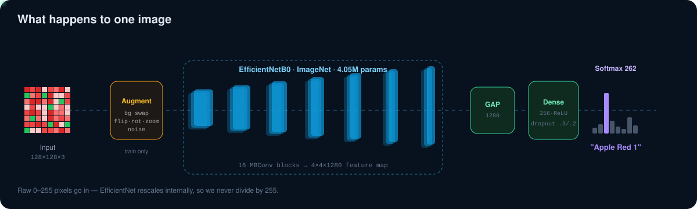
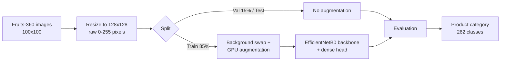

<div align="center">



<br/>

<a href="https://github.com/Mohanad234128/Retail-Product-Recognition-System-Computer-Vision-ITI/stargazers"></a>
<a href="https://github.com/Mohanad234128/Retail-Product-Recognition-System-Computer-Vision-ITI/network/members"></a>


<br/><br/>


<br/><br/>



<br/>

<a href="#-agrovision-app"><b>▶ Try the app</b></a> &nbsp;·&nbsp; <a href="#-how-the-model-sees"><b>👁 How it sees</b></a> &nbsp;·&nbsp; <a href="#-results"><b>📊 Results</b></a> &nbsp;·&nbsp; <a href="#-getting-started"><b>🚀 Get started</b></a>

</div>


## 🛒 Overview

Manual product recognition in retail and warehouse environments is **slow, error-prone, and impossible to scale**. This project fine-tunes a pretrained **EfficientNetB0** convolutional network to look at a single product image and predict its category — the kind of building block that powers automated checkout, sorting, and inventory-tracking pipelines.

As a representative retail product domain, the system is trained and evaluated on the **Fruits‑360** dataset — **262 categories** of fruits, vegetables and nuts, **184,838 images** (138,642 training + 46,196 test) captured from multiple rotation angles against a uniform background. A companion Streamlit app, **AgroVision**, lets anyone scan one or many images and see the predicted class, its type (Fruit / Vegetable / Nut) and the model's confidence.

<div align="center">

</div>

<details>
<summary><b>📚 Table of contents</b></summary>

- [Overview](#-overview) · [How the model sees](#-how-the-model-sees) · [Dataset](#-dataset) · [Pipeline](#-pipeline)
- [Model Architecture](#-model-architecture) · [Training](#-training-configuration) · [Results](#-results) · [Key Insights](#-key-insights)
- [AgroVision App](#-agrovision-app) · [Project Structure](#-project-structure) · [Getting Started](#-getting-started)
- [Roadmap](#-roadmap) · [Tech Stack](#-tech-stack) · [Team](#-team) · [Contributing](#-contributing)

</details>

<br/>


## 👁 How the Model Sees

A computer never sees "an apple". It sees a **128 × 128 × 3 grid of numbers** — 49,152 of them — and has to turn that into a name.

```text
   what you see            what the network receives                what it answers
  ┌────────────┐      ┌─────────────────────────────────┐      ┌───────────────────────────┐
  │    🍎      │ ───▶ │ [[214, 38, 41], [219, 40, 44],  │ ───▶ │ Apple Red 1        99.2 % │
  │            │      │  [211, 35, 39], ... ×16,384]    │      │ Apple Red 2         0.5 % │
  └────────────┘      └─────────────────────────────────┘      │ Apple Red 3         0.2 % │
                                                               └───────────────────────────┘
```

Inside the backbone the picture is passed through **16 MBConv blocks**. The early layers fire on **edges and colour blobs**, the middle layers on **textures and shapes** (skin dimples, stems, leaf-like contours) and the last layers on **whole-object evidence** — compressed into a 4 × 4 × 1280 feature map, averaged into one 1,280-number "fingerprint" of the image and scored against all 262 classes.

| Stage | What it responds to | Rough analogy |
|:--|:--|:--|
| Early layers | edges · colour gradients · highlights | "Is there a curved red edge?" |
| Middle layers | texture · surface pattern · outline | "Smooth skin, round, small stem dip" |
| Late layers | object parts & combinations | "That's an apple, probably a red one" |
| Dense head (trained by us) | which of the 262 labels fits that fingerprint | "…specifically *Apple Red 1*" |


## 📦 Dataset

<div align="center">

| Attribute | Value |
|---|---|
| **Source** | [Kaggle — Fruits‑360](https://www.kaggle.com/datasets/moltean/fruits) (`moltean/fruits`) |
| **Categories** | 262 fruits, vegetables & nuts |
| **Training folder** | 138,642 images → split 85 / 15 into **117,846 train** and **20,796 validation** |
| **Test images** | 46,196 (kept separate, used only for the final evaluation) |
| **Native image size** | 100 × 100 px, RGB (resized to 128 × 128 for the model) |
| **Capture style** | Multiple rotation angles per physical sample, uniform white background & lighting |

</div>

<br/>


## 🔄 Pipeline



<details>
<summary>Same flow as a diagram</summary>




</details>

Images are read straight from the folder structure with `image_dataset_from_directory`. Pixels stay in the raw `0–255` range — EfficientNetB0 rescales and normalises internally, so dividing by 255 would feed it near-zero inputs. The **training set only** is augmented: roughly half of the white studio backgrounds are swapped for random colour / gradient / noise backgrounds, then the images get a horizontal flip, small rotation, zoom and shift, brightness and contrast jitter, and mild Gaussian noise. Validation and test images are never augmented, keeping evaluation unbiased.

<br/>


## 🧠 Model Architecture

**Transfer learning** with an ImageNet-pretrained **EfficientNetB0** backbone and a small dense classification head, built with the Keras Functional API.

<div align="center">

| Layer | Output Shape | Parameters |
|---|---|---|
| Input | (128, 128, 3) | 0 |
| EfficientNetB0 (ImageNet weights, `include_top=False`) | (4, 4, 1280) | 4,049,571 |
| GlobalAveragePooling2D | (1280) | 0 |
| Dropout (0.3) | (1280) | 0 |
| Dense (256, ReLU) | (256) | 327,936 |
| Dropout (0.2) | (256) | 0 |
| Dense (262, Softmax, float32) | (262) | 67,334 |

**Total parameters: 4,444,841** · trainable in phase 1: **395,270** (the head)

</div>

<br/>


## ⚙️ Training Configuration

Training ran in two phases on Kaggle (2 × Tesla T4, mixed precision `float16`).

<div align="center">

| Setting | Phase 1 — frozen backbone | Phase 2 — fine-tuning |
|---|---|---|
| Trainable layers | Dense head only | Head + top 30 backbone layers |
| Optimizer | Adam, lr = 1e-3 | Adam, lr = 1e-5 |
| Max epochs | 15 | 10 |
| Epochs actually run | 15 | 6 (early stopping) |
| Batch size | 128 | 128 |
| Loss | Categorical crossentropy | Categorical crossentropy |
| Callbacks | `ReduceLROnPlateau` (val_loss, ×0.2, patience 2) · `EarlyStopping` (val_loss, patience 5, restore best) · `ModelCheckpoint` (best val_accuracy) | same |

</div>

<br/>


## 📊 Results

<div align="center">

### 🏆 Held-out test accuracy: `87.81%` · test loss `0.5005` (46,196 images)

Best validation accuracy: `92.76%` (phase 1, epoch 15)

</div>



<details>
<summary><b>Phase 1 — per-epoch numbers (frozen backbone)</b></summary>
<br/>

<div align="center">

| Epoch | Train Acc | Val Acc | Val Loss |
|:---:|:---:|:---:|:---:|
| 1 | 59.89% | 83.43% | 0.5321 |
| 2 | 77.09% | 86.29% | 0.3955 |
| 3 | 80.31% | 90.05% | 0.2932 |
| 4 | 81.91% | 88.15% | 0.3427 |
| 5 | 82.91% | 90.69% | 0.2620 |
| 6 | 83.52% | 90.03% | 0.2693 |
| 7 | 84.08% | 90.28% | 0.2778 |
| 8 | 85.66% | 92.72% | 0.2100 |
| 9 | 86.14% | 91.38% | 0.2382 |
| 10 | 86.60% | 91.71% | 0.2131 |
| 11 | 87.00% | 92.40% | 0.2032 |
| 12 | 87.07% | 92.19% | 0.2052 |
| 13 | 87.18% | 92.55% | 0.2007 |
| 14 | 87.26% | 92.22% | 0.2037 |
| **15** | **87.25%** | **92.76%** | **0.1993** |

</div>

</details>

**Phase 2 — fine-tuning the top 30 backbone layers** (6 epochs): validation accuracy stayed between **92.54% and 92.69%** and never beat the phase 1 checkpoint, so early stopping ended the phase; the saved `best_fruits_model.keras` checkpoint tracks the best validation accuracy (phase 1).

**Per-class results (test set):** macro F1 ≈ **0.87**; **122** of 262 classes score F1 ≥ 0.95 and **161** score ≥ 0.90, while **19** classes fall below 0.60.

<div align="center">

| Weakest classes (test F1) | |
|---|---|
| `BlackBerry 4`, `Blackberry 1`, `Blackberry 2`, `Blackberry 3`, `Cantaloupe 2` | 0.00 |
| `Apple Crimson Snow 1` | 0.11 |
| `Pepper Yellow 1` | 0.12 |
| `Cherry Wax Red 3` · `Cherry Wax Red 1` | 0.16 · 0.23 |

</div>

> 📝 **Evaluation note:** the notebook output shows the Training folder spells one class `BlackBerry 4` (capital B) while the Test folder uses `Blackberry 4`. Sorted alphabetically, the two folders therefore list these classes in a different order, which shifts the label indices of `BlackBerry 4` and `Blackberry 1–3` by one — exactly the four classes scoring 0.00. This is an evaluation artifact, not a model failure; the reported 87.81% is slightly **understated** (these four classes are ≈1.4% of the test images). Passing `class_names=` from the training set when loading the Test folder fixes it. `Cantaloupe 2` (0.00) is unrelated to this and still needs investigating.

<br/>


## 💡 Key Insights

> 🧠 **Fun scale check:** the model has seen about **117,846 training images × 21 epochs ≈ 2.5 million image-views** and now fits in a **~21 MB** file — small enough to run on a laptop CPU.

- **87.81% on a separate test set across 262 classes**, using a model with only **4.4 M parameters**.
- **Validation (92.76%) is higher than test (87.81%)** because validation is a random 15% slice of the training folders, where near-identical rotations of the same fruit can fall on both sides of the split. The test set is the fairer number.
- **Train accuracy sits below validation accuracy** because it is measured on heavily augmented images with dropout active, while validation is clean.
- **Fine-tuning did not help here:** unfreezing the top 30 backbone layers left validation flat, so the frozen-backbone head was the better stopping point.
- **Background-swap augmentation** was added because every Fruits-360 image has the same white studio background; it is meant to stop the model from treating "white surroundings" as part of the class and to help on real photos.

**Baseline comparison**

<div align="center">

| | Baseline (v1) | Final (v2) |
|---|---|---|
| Model | CNN from scratch (3 conv + 2 dense) | EfficientNetB0 transfer learning |
| Parameters | 82.8 M | 4.4 M |
| Classes | 260 | 262 |
| Input | 100×100, rescaled to [0, 1] | 128×128, raw 0–255 |
| Accuracy on the test images | 94.18% (5 epochs, 45,724 images) | 87.81% (46,196 images) |

</div>

v1 reaches a higher score on the clean Fruits-360 test images, but it is **~19× larger**, was trained on studio backgrounds only, and is more likely to depend on them. v2 is a deliberate trade: a far smaller, faster model, trained with background-swap augmentation to generalise beyond the white studio setting. Part of the gap is also an evaluation artifact (see the note above), and the class lists differ slightly (260 vs 262), so the comparison is indicative, not strictly like-for-like. Real-world photos are the true test for choosing between them.

**Recommended next steps:**

- 🔍 Re-run the test evaluation with the training `class_names` (Blackberry fix) and investigate `Cantaloupe 2`
- 📸 Collect a small set of real photos (kitchen, shelf, hand-held) to measure real-world accuracy, not just Fruits-360 accuracy
- 🌆 Use real background images in the augmentation instead of synthetic ones
- 🎯 Add targeted data for the weakest classes (cherry, apple and pepper variants)
- 📈 Try a larger EfficientNet variant or a higher input resolution

<br/>


## 🌱 AgroVision App

**AgroVision** is a multi-page Streamlit showcase for the model (folder `UI/`):

- 🏠 **Home** — animated landing page with the headline metrics
- 🔍 **Live Demo** — upload **one or many** images; every image is scanned independently and gets its own card with the predicted name, a **Fruit / Vegetable / Nut** label, a confidence bar and the runner-up guesses, plus copyable results and a CSV download
- 📊 **Model Insights** — training curves for both phases, parameter breakdown and the weakest classes
- 🗂 **Class Gallery** — all 262 classes grouped by produce type, searchable
- ✨ **About** — project background and team, with a light / dark theme toggle on every page

All numbers shown in the app come from a single file, `UI/metrics.py`.

<br/>


## 🗂 Project Structure

```
Retail-Product-Recognition-System-Computer-Vision-ITI/
├── Docs/            # Written report & documentation
├── Model/           # model.h5 and best_fruits_model.keras (EfficientNetB0, 262 classes)
├── NoteBook/        # iti-gradution.ipynb (v1 baseline CNN) · iti-gradution-final.ipynb (EfficientNetB0) · test-the-model.ipynb
├── Presentation/    # Project presentation slides
├── UI/              # AgroVision Streamlit app (app.py, metrics.py, views/ ...)
├── requirements.txt # Python dependencies
└── README.md
```

<br/>


## 🚀 Getting Started

```bash
# 1. Clone the repository
git clone https://github.com/Mohanad234128/Retail-Product-Recognition-System-Computer-Vision-ITI.git
cd Retail-Product-Recognition-System-Computer-Vision-ITI

# 2. Run the AgroVision app
cd UI
python -m venv .venv && .venv\Scripts\activate      # Windows  (macOS/Linux: source .venv/bin/activate)
python -m pip install -r requirements.txt            # needs TensorFlow >= 2.20
streamlit run app.py                                 # finds Model/model.h5 automatically

# 3. (Optional) Retrain: download Fruits-360 from Kaggle
#    https://www.kaggle.com/datasets/moltean/fruits
#    then run NoteBook/iti-gradution-final.ipynb end-to-end (GPU recommended)
```

<br/>


## 🗺 Roadmap

- [x] Baseline from-scratch CNN (v1, 5 epochs)
- [x] EfficientNetB0 transfer learning with background-swap augmentation (v2)
- [x] Two-phase training (frozen backbone + fine-tuning) and held-out test evaluation
- [x] Per-class precision / recall / F1 report
- [x] AgroVision Streamlit app with multi-image scanning
- [ ] Re-evaluate with consistent class order (Blackberry label shift) and investigate Cantaloupe 2
- [ ] Evaluate on real-world photos with natural backgrounds
- [ ] Targeted data and real backgrounds for the weakest classes
- [ ] Deployment-ready inference API

<br/>


## 🧰 Tech Stack

<div align="center">


</div>

<br/>


## 👥 Team

<div align="center">

| Name | GitHub |
|---|---|
| Yasser Mogahed | [@Yasser-Mogahed](https://github.com/Yasser-Mogahed) |
| Abdallah Ali | [@abdallah-farahat](https://github.com/abdallah-farahat) |
| Mohanad Ibrahim | [@Mohanad234128](https://github.com/Mohanad234128) |
| Faisal Abdulaziz | [@Wttcss](https://github.com/Wttcss) |
| Marawan Mohamed | [@luka666-grim](https://github.com/luka666-grim) |

</div>

<br/>


## 🤝 Contributing

Contributions, issues, and feature requests are welcome! Feel free to check the [issues page](https://github.com/Mohanad234128/Retail-Product-Recognition-System-Computer-Vision-ITI/issues) or open a pull request.

1. Fork the project
2. Create your feature branch (`git checkout -b feature/amazing-feature`)
3. Commit your changes (`git commit -m 'Add amazing feature'`)
4. Push to the branch (`git push origin feature/amazing-feature`)
5. Open a Pull Request

<br/>


## 📬 Contact

<div align="center">

Built as part of the **ITI AI and Machine Learning Foundation Track**.


<br/>

⭐ **If this project helped you, consider giving it a star!** ⭐


</div>
